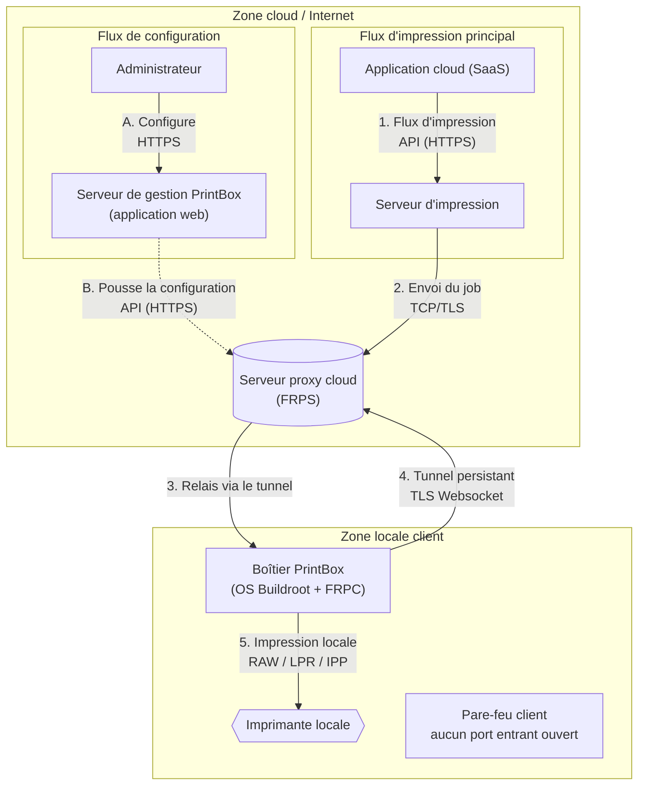
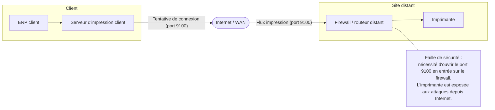
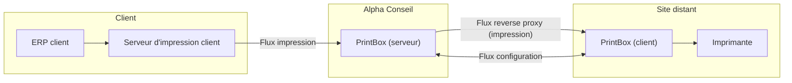
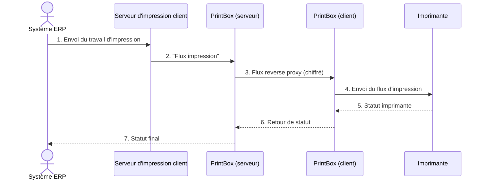

# Exemple 1 – Routeur d'impression cloud

> Fiche de présentation E6 d'un apprenti d'une session précédente, **anonymisée** : noms de personnes, d'entreprises, de produits, adresses, SIRET et coordonnées sont fictifs. Le contenu technique est conservé tel que rédigé par l'étudiant (fautes comprises). Les schémas ont été redessinés en mermaid.

**Académie de Lyon – Fiche présentation Projet E6 IR – candidat apprenti**

| Centre de formation | BTS CIEL | Session |
|---|---|---|
| CFA Exemple 1 rue de l'Exemple, 00000 Ville-Exemple Tél. : 00 00 00 00 00 contact@cfa-exemple.fr | Option A Informatique et Réseaux | Session 2026 Candidat apprenti |

## PrintBox – Solution d'impression applicative

**L'apprenti :**
Nom : LEROY – Prénom : Thomas
Service dans lequel il travail : Infrastructure Réseaux

**L'entreprise d'accueil :**
Nom : Alpha Conseil
Adresse : 10 rue des Lilas, 00000 Ville-Exemple
Siret : 000 000 000 00000
Activité principale : Société de conseil et de développement logiciel spécialisée

**Tuteur**
Nom : MOREAU – Prénom : Julien
Fonction : CEO – Diplôme : Ingénieur Génie Logiciel

**Centre de formation :**
Nom : CFA Exemple
Professeur de Sciences et techniques Industriels – Nom : DUPONT – Prénom : Jean
Professeur de Sciences Physiques – Nom : MARTIN – Prénom : Claire

---

### Synthèse du projet

Le projet PrintBox propose une solution pour permettre aux entreprises d'imprimer en toute sécurité depuis leurs applications en ligne (cloud) vers leurs imprimantes locales, même si ces dernières sont dans un réseau isolé. Il s'agit de développer un boîtier intelligent avec un système d'exploitation dédié qui crée une connexion sécurisée vers le cloud pour gérer les impressions, sans exposer le réseau interne de l'entreprise.

### Présentation de l'entreprise

Alpha Conseil est une société de conseil et de développement logiciel créée en 2018. Elle est spécialisée dans l'Output Management, capitalisant sur une longue expérience dans la gestion des flux de documents pour des grands comptes. Sa mission est de concevoir des solutions fiables pour la production et la distribution de documents, notamment via sa suite logicielle « PrintSuite » dédiée à la modernisation de l'impression à l'ère du cloud.

### Présentation générale du système supportant le projet

Le projet s'articule autour du boîtier matériel « FriendlyElec NanoPi R3S ». Le travail consiste à créer un OS embarqué minimaliste sur mesure via Buildroot (un outil permettant de construire des systèmes Linux personnalisés), en partant d'une analyse bas niveau de la carte pour générer un device tree (un fichier décrivant le matériel pour le système d'exploitation) adapté, ce dernier n'étant pas disponible pour un OS minimaliste.

L'OS héberge deux clients distincts communiquant avec le serveur cloud :

- **Client FRPC** : un client « FRP » (Fast Reverse Proxy) qui initie un tunnel TLS 1.3 sécurisé (une connexion chiffrée de dernière génération) vers le serveur proxy (FRPS) pour le transit des flux d'impression.
- **Client PrintSuite** : un agent de monitoring et de configuration (développé en Go) qui communique via une API dédiée pour la supervision, la configuration à distance et la gestion des mises à jour du boîtier.

### Analyse de l'existant

Avec la généralisation des applications métier hébergées dans le cloud (SaaS), l'impression vers une imprimante située dans un réseau local protégé est devenue un défi technique majeur. Les solutions traditionnelles sont inadaptées : l'ouverture de ports (NAT) crée une faille de sécurité ; le VPN est lourd à déployer et étend la surface d'attaque ; et le « Pull Printing » ne permet pas l'impression instantanée requise dans les milieux industriels. Face à ces limites, une nouvelle approche sécurisée et efficace est indispensable.

### Expression du besoin / problème à résoudre / Contraintes techniques

**Besoin :** Les entreprises ont besoin d'une solution unifiée, sécurisée et simple à déployer pour permettre l'impression depuis des applications cloud vers leurs imprimantes locales.

**Problème :** Relayer de manière sécurisée et instantanée un flux d'impression depuis Internet vers un réseau local protégé ou isoler, sans exposer ce dernier.

**Contraintes techniques :** Utilisation obligatoire du matériel FriendlyElec NanoPi R3S. L'OS doit être minimaliste, sans interface graphique et entièrement gérable à distance. Chiffrement TLS 1.3 obligatoire. Temps de mise en service sur site < 5 minutes.

### Énoncé des tâches à réaliser par l'apprenti

- **Phase 1 (Conception) :**
  - Analyse électronique approfondie des spécifications du NanoPi R3S (schémas, CPU, contrôleurs réseau) pour identifier les requis du device tree.
  - Installation de l'environnement Buildroot.
  - Conception de l'architecture logicielle (dual-client) et de l'API REST du serveur de gestion.
- **Phase 2 (OS Embarqué – Cœur technique) :**
  - Création du « device tree » (DTS) pour la carte NanoPi R3S, décrivant l'architecture matérielle pour le noyau Linux.
  - Configuration de Buildroot pour générer une image Linux minimale (kernel, bootloader, rootfs) intégrant ce device tree.
  - Intégration et configuration du package client FRPC.
  - Développement et intégration du client PrintSuite pour le monitoring et la configuration.
  - Création des scripts de démarrage (systemd/init.d) pour lancer les deux clients en tant que services.
- **Phase 3 (Serveur) :**
  - Développement du backend en Go (serveur de gestion et API REST).
  - Création de la base de données (gestion des boîtiers, statuts, configurations).
  - Développement du tableau de bord (Frontend) pour l'administration.
  - Implémentation du module de gestion des mises à jour à distance (via le client PrintSuite).
- **Phase 4 (Tests) :**
  - Tests de connexion des deux clients (FRPC et PrintSuite) au serveur.
  - Validation fonctionnelle des redirections de flux d'impression et des changements de configuration.
  - Tests de charge et de latence du tunnel.
- **Phase 5 (Finalisation) :**
  - Rédaction de la documentation technique (incluant l'architecture de l'OS et le processus de build) et du guide administrateur.

**Contexte d'application :**
Cloud, Cybersécurité (tunnel sécurisé, évitement NAT/VPN), Supervision (monitoring état), Réseau (proxy inversé, redirections), Milieu industriel (impression instantanée).

### Description des entrées et données

| Entrées | Descriptions | |
|---|---|---|
| Capteurs | | [ ] |
| Données collectées | Statut du boitier (en ligne / hors ligne) via monitoring. | [X] |
| Flux entrants | Travaux d'impression (Flux TCP/TLS) ; Configuration (via API HTTPS). | [X] |
| API | API REST pour la configuration et la consultation de l'état. | [X] |
| Fichiers | Fichiers de mise à jour logicielle ; Jobs d'impression. | [X] |

**Sorties du système :**

| Résultats produits | Descriptions | |
|---|---|---|
| Commandes d'actionneurs | Envoi du flux d'impression (RAW / LPR / IPP) à l'imprimante locale. | [X] |
| Visualisations (IHM) | Tableau de bord web : visualisation de l'état des boitiers, configuration des redirections réseau. | [X] |
| Alertes | Notifications en cas de problème ou d'anomalie du boîtier. | [X] |
| API | Remontée de statut (monitoring) vers le serveur, via tunnel ou Websockets. | [X] |
| Logs | Enregistrement des événements et activités du système pour le diagnostic. | [X] |

### Ressources mobilisées

- **Matériel :** Boitier Client : FriendlyElec NanoPi R3S (CPU ARM 64-bit, 1GB RAM, 2 ports Gbps Ethernet). Serveur de développement : VM sous Linux Dietpi. Serveur de production : VM sur cloud provider (Dietpi).
- **Logiciel :** Environnement de build : Buildroot. Proxy : FRP (Fast Reverse Proxy). Langages : Go (Backend Serveur), (Frontend Serveur, Vue.js). IDE : Visual Studio Code.
- **Organisation :** Méthodologie Agile avec points hebdomadaires. Gestion de projet GIT.

### Résultats obtenus

Un démonstrateur fonctionnel comprenant : le boîtier physique (NanoPi R3S) doté d'un OS sur mesure qui établit un tunnel TLS persistant vers un proxy cloud. Une application web (serveur de gestion) permettant le monitoring de l'état du boîtier et la configuration à distance des redirections réseau, réalisant ainsi une mise en service effective du service d'impression.

---

## Annexe

### Schéma d'architecture de la solution

### Avant

### Après

### Séquence du flux d'impression

*La fiche originale contenait ensuite la grille d'auto-évaluation (voir `grille_auto_eval-1.pdf`) et la page « Avis de la commission » du modèle officiel, non reproduites ici.*
