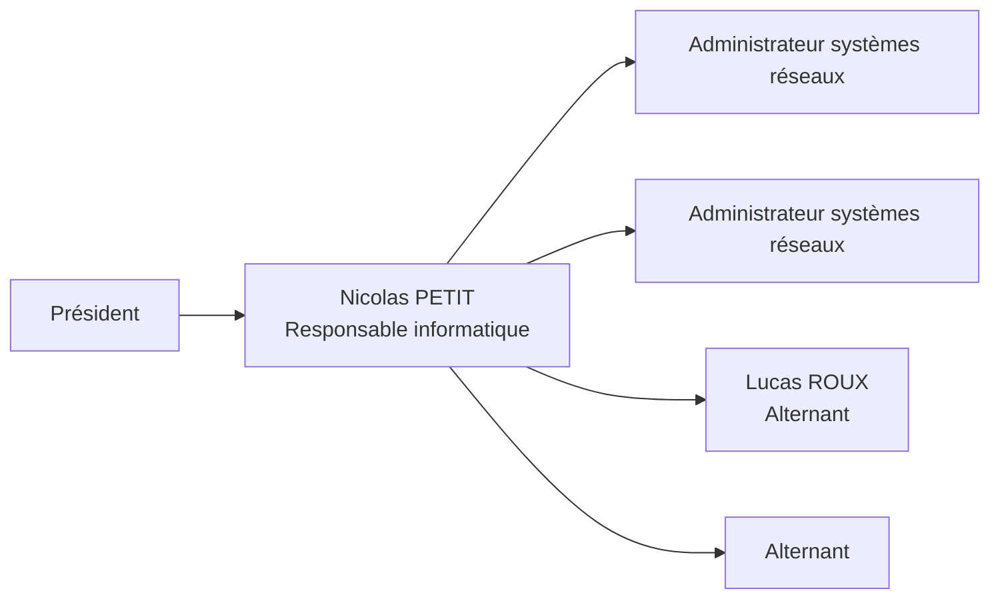
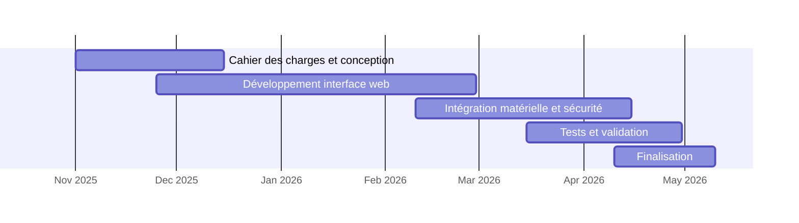
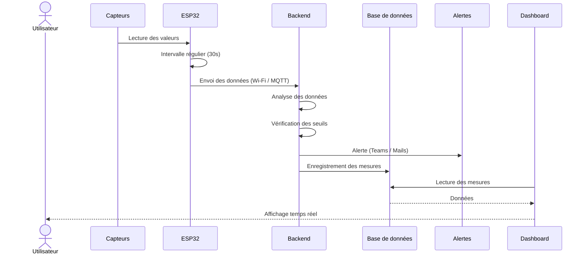
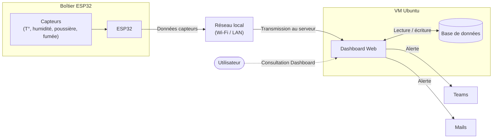
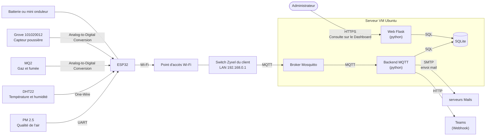

# Exemple 2 – Supervision de baie et machines en milieu industriel

> Fiche de présentation E6 d'un apprenti d'une session précédente, **anonymisée** : noms de personnes, d'entreprises, adresses, SIRET, chiffre d'affaires et coordonnées sont fictifs. Le contenu technique est conservé tel que rédigé par l'étudiant (fautes comprises). Les schémas ont été redessinés en mermaid ; les photos ne sont pas reproduites.

**Académie de Lyon – Fiche présentation Projet E6 IR – candidat apprenti**

| Centre de formation | BTS CIEL | Session |
|---|---|---|
| CFA Exemple<br>1 rue de l'Exemple, 00000 Ville-Exemple<br>Téléphone : 00 00 00 00 00<br>contact@cfa-exemple.fr | Option A Informatique et Réseaux | Session 2026<br>Candidat apprenti |

## Supervision de baie et machine en milieu industriel

**L'apprenti :**
Nom : ROUX
Prénom : Lucas
Service dans lequel il travaille : Service informatique

**L'entreprise d'accueil :**
Nom : BETA SERVICES
Adresse : 5 avenue des Tilleuls, 00000 Ville-Exemple
Siret : 000 000 000 00000
Activité principale : Téléphonie, Opérateur, Informatique

**Tuteur**
Nom : PETIT – Prénom : Nicolas
Fonction : Responsable de la Branche informatique – Diplôme :

**Centre de formation :**
Nom : CFA Exemple
Professeur de Sciences et techniques Industriels – Nom : DUPONT/BERNARD – Prénom : Jean/Luc
Professeur de Sciences Physiques – Nom : MARTIN – Prénom : Claire

---

### Synthèse du projet

La Tôlerie Delta est une entreprise spécialisée dans la découpe, le pliage et la fabrication sur-mesure de pièces métalliques pour l'industrie. Elle exploite ses équipements informatiques et ses machines dans un environnement industriel difficile, ce qui fragilise le matériel et risque de provoquer des arrêts de production.

Le projet vise à assurer la continuité de fonctionnement de machines industrielles sensibles à l'environnement.
Le boîtier collecte en temps réel la température, l'humidité et la qualité de l'air autour des équipements.
L'ESP32 publie ces valeurs en MQTT, un backend analyse les seuils, les stocke en base de données et génère des alertes immédiates publiées sur un canal Teams en cas de risque.
Le Dashboard permet au service informatique d'avoir une visibilité continue et de passer d'une maintenance réactive à préventive.

### Présentation de l'entreprise

Beta Services est le prestataire informatique de la Tôlerie Delta.
Beta Services est une société spécialisée dans trois domaines complémentaires :

- L'informatique, à travers la maintenance, l'infogérance et la mise en place d'infrastructures serveurs et réseaux.
- La fonction d'opérateur, garantissant la connectivité et la performance des réseaux.
- La téléphonie, avec des solutions professionnelles sur mesure adaptées aux besoins de communication de chaque client.

L'entreprise réalise un chiffre d'affaires de plusieurs millions d'euros.
Elle accompagne plusieurs dizaines de clients, entreprises, collectivités et établissements scolaires dans la gestion, la sécurisation et l'amélioration de leurs infrastructures numériques.



### Présentation générale du système supportant le projet

L'infrastructure numérique de l'entreprise, est indispensable à la continuité de la production. Il comprend la baie de brassage centrale qui héberge les équipements critiques (serveurs, stockage, actifs réseau) et les machines industrielles dépendant de cette connectivité.
Ces équipements sont exploités dans un environnement industriel difficile, ce qui expose le matériel à des contraintes physiques (variations thermiques, poussière) et fragilise leur fonctionnement.
La surveillance de l'environnement physique et de l'état des équipements est actuellement assurée par des rondes de maintenance effectuées par le personnel technique.
L'infrastructure ne dispose d'aucun système de télémétrie automatisée permettant la collecte et l'historisation des données environnementales en temps réel (température, humidité, qualité de l'air).

### Analyse de l'existant

L'infrastructure informatique et les machines de l'atelier sont soumises à des contraintes environnementales fortes : présence de poussières et variations de température.

Actuellement, aucun dispositif technique ne mesure l'impact réel de ces facteurs sur le matériel : les équipements sont dépourvus de sondes connectées et ne collecte aucun historique de données exploitable. Cette absence d'historique empêche toute analyse prédictive des risques.

La surveillance repose donc entièrement sur l'humain, via des contrôles visuels aléatoires. Cette méthode présente des failles majeures, notamment durant les nuits et les week-ends où aucune vérification n'est effectuée. Le service informatique reste donc dans une posture purement réactive : une défaillance de la ventilation ou une surchauffe progressive passera inaperçue jusqu'à provoquer l'arrêt brutal des équipements.

Cette absence de visibilité réduit considérablement la durée de vie des équipements et fait peser une menace constante sur l'intégrité des données en cas d'arrêt inopiné. Le passage vers une solution de télémétrie automatisée est alors indispensable pour sécuriser la continuité de service et passer d'une maintenance réactive à une maintenance préventive.

Voici des machines importantes pour le fonctionnement de l'entreprise :

*[Photos d'une découpeuse et d'une plieuse – non reproduites]*

### Expression du besoin / problème à résoudre / Contraintes techniques

L'absence de personnel technique permanent sur site rend impossible la surveillance physique continue des équipements, alors même que le système est critique pour la continuité de l'entreprise.

Le problème consiste à sécuriser la disponibilité de cette infrastructure en anticipant les incidents environnementaux (surchauffe, défaut de ventilation, poussière trop importante…) qui pourraient provoquer un arrêt de production coûteux. Le besoin est donc de concevoir une solution de télémétrie automatisée capable de mesurer les indicateurs physiques en temps réel et de notifier instantanément les équipes techniques en cas de dérive.

Pour cela, un seuil de sécurité est défini pour chaque capteur et stocké côté serveur. Ces seuils sont configurables par l'administrateur. À chaque mesure reçue, le système compare la valeur au seuil associé : en cas de dépassement, un événement est enregistré avec le statut « critique » et déclenche automatiquement une alerte Teams ou mail via un webhook. Ce mécanisme garantit une détection immédiate des situations anormales.

Pour garantir la fiabilité et la performance de ce dispositif, plusieurs exigences doivent être respectées :

- **Autonomie et Résilience :** Le boîtier doit être capable de fonctionner sur batterie en cas de coupure de courant pour maintenir l'alerte.
- **Fiabilité Matérielle :** Il doit être conçu pour résister à la poussière et aux variations thermiques de l'environnement industriel.
- **Connectivité et Sécurité :** La transmission des données via Wi-Fi vers le serveur (VM) doit être sécurisée et chiffrée.
- **Réactivité :** Le système d'alerte doit être immédiat (Push Teams / Mails) pour permettre une intervention rapide et préventive.
- **Supervision et Évolutivité :** Les données doivent être consultables sur un Dashboard ergonomique, dont l'architecture permettra l'ajout futur de nouveaux capteurs.

### Fonctionnement du système

Le boîtier basé sur l'ESP32 effectue un relevé périodique des paramètres environnementaux (température, humidité, niveau de particules fines et concentration de gaz) et publie ces valeurs au format JSON via MQTT sur le réseau local, à destination du serveur.

Format JSON :

```json
{ "temp": 26.4,
  "humidity": 61,
  "smoke": 0,
  "air_quality": 78,
  "timestamp": "2026-01-05T09:14:22"
}
```

Le backend développé en Python sous Flask, analyse chaque mesure reçue ; en cas de dépassement des seuils définis (par exemple température > 35 °C ou particules > 200 ppm), il enregistre un événement critique en base et déclenche immédiatement l'envoi d'une alerte via message Teams par Webhook sécurisé ou par mail SMTP.

En parallèle, l'ensemble des données est horodaté et stocké dans une base SQLite afin de permettre une visualisation historique sur un tableau de bord accessible par navigateur web, présentant en temps réel les valeurs instantanées, l'évolution des paramètres sur les dernières 24 heures et les alertes actives avec leur date et leur niveau de gravité, permettant ainsi d'anticiper l'arrêt des machines et d'assurer une maintenance préventive dans un environnement industriel exposé à la poussière, aux variations thermiques et aux défauts de ventilation.

### Énoncé des tâches à réaliser par l'apprenti

| Tâche | Description | Compétence mobilisée |
|---|---|---|
| Analyse du besoin | Recueillir les informations sur l'environnement du client et définir les paramètres à surveiller. | C01 |
| Rédaction des documents | Produire la documentation projet, le cahier des charges et la présentation finale. | C01 |
| Conception du boîtier | Définir la forme, l'organisation interne et la disposition de l'ESP32 et des capteurs. | C03 |
| Choix du matériel | Sélectionner les capteurs (température, humidité, poussière, fumée…) et le type d'alimentation. | C03 |
| Assemblage du boîtier | Installer les capteurs, câbler l'ESP32, préparer l'alimentation et rendre l'ensemble fonctionnel. | C08 |
| Développement du programme ESP32 | Programmer l'ESP32 pour lire les capteurs, gérer les seuils et préparer l'envoi des données. | C08 |
| Développement du Dashboard | Créer l'interface web pour visualiser les informations en temps réel et l'état de la baie. | C08 |
| Sécurisation du système | Mise en place de l'authentification sur le Dashboard et chiffrement des communications. | C10 |
| Communication ESP32 → Dashboard | Configurer le Wi-Fi, l'API ou MQTT pour transmettre les données. | C10 |
| Mise en place des alertes | Configurer les alertes (Teams ou Mails) en cas de dépassement de seuil. | C10 |
| Tests et validation | Vérifier les capteurs, le boîtier, la communication et la fiabilité du Dashboard. | C03 |

**Contexte d'application :**
Le projet s'inscrit dans un contexte industriel où la supervision et la surveillance environnementale de la baie informatique sont essentielles pour assurer la continuité de service.

### Description des entrées et données

| Entrées | Descriptions | |
|---|---|---|
| Capteurs | Température ; Humidité ; Gaz ; Fumée (début d'incendie) ; Poussière ; Qualité de l'air | X |
| Données collectées | Valeurs des capteurs (température, humidité, gaz, fumée, qualité de l'air…) ; États (normal / alerte) ; Horodatage des mesures | X |
| Flux entrants | Valeurs des capteurs (température, humidité, gaz, fumée, qualité de l'air...) ; États (normal / alerte) ; Horodatage des mesures | X |
| API | | |
| Fichiers | | |

**Sorties du système :**

| Résultats produits | Descriptions | |
|---|---|---|
| Commandes d'actionneurs | | |
| Visualisations (IHM) | Dashboard affichant en temps réel les valeurs des capteurs et l'état de la baie. | X |
| Alertes | Envoi d'alertes via Teams ou Mails en cas de dépassement de seuil. | X |
| API | | |
| Logs | Historique des mesures enregistré dans le Dashboard. | X |

### Ressources mobilisées

**Matériel :**

- VM Ubuntu Server 22.04 pour héberger le dashboard et la base de données.
- Point d'accès / Wi-Fi du client pour la communication.
- Routeur / Switch du réseau local.
- Boîtier autonome basé sur ESP32.
- Capteurs environnementaux : DHT22 (Temp/Hum), MQ-2 (Fumée), Grove 101020012 (Poussière), PM 2.5 (qualité de l'air).

**Logiciel :**

- Arduino IDE (Programmation C++ du firmware ESP32).
- Python & Framework Flask (Développement du Dashboard et API).
- SQLite (Base de données pour l'historique).
- Ubuntu Server 22.04 (OS Serveur).

**Organisation :**

- GitHub pour le Versionning du code.
- Trello pour le suivi des tâches.
- Méthodologie agile (itérative) avec tests réguliers.

### Résultats obtenus

**Démonstrateur fonctionnel (Prototype) :** Un boîtier IoT autonome a été réalisé, assemblé et testé en conditions réelles. Il assure la collecte stable des métriques environnementales et leur transmission sécurisée vers le serveur.

**Interface de supervision opérationnelle :** Le Dashboard web est pleinement fonctionnel : il permet au service informatique de visualiser l'état de la baie en temps réel et de consulter l'historique. La chaîne d'alerte (Teams/Mails) est active et notifie instantanément les équipes techniques en cas de dépassement de seuil critique.

**Bilan technique et professionnel :**

Ce projet transversal mobilise et valide l'ensemble des compétences du référentiel :

- **Développement (C08) :** Conception du firmware embarqué (C++) et du backend de supervision (Python/Flask).
- **Réseaux (C10) :** Intégration du dispositif dans l'infrastructure existante et gestion des flux Wi-Fi.
- **Cybersécurité :** Sécurisation de l'architecture par segmentation réseau (VLAN) et authentification des accès.
- **Gestion de Projet :** Respect du planning (Gantt) et suivi collaboratif (Trello/Git).

---

## Annexes

### Diagramme de Gantt



### Diagramme de séquence



### Diagramme de déploiement



### Synoptique de l'architecture matérielle et logicielle



L'ESP32 envoie toutes les 30 secondes un message JSON avec température + humidité + qualité air via MQTT.
Le backend récupère ce message, vérifie les seuils et insère les données en BDD.
S'il détecte un dépassement, il déclenche directement l'envoi d'une alerte mail ou Teams.

### Maquette page d'accueil du Dashboard

```text
┌───────────────────────────────────────────────────────────────┐
│               DASHBOARD - SURVEILLANCE DE BAIE                │
└───────────────────────────────────────────────────────────────┘
┌───────────────────────────────────────────────────────────────┐
│ Température  │ Poussières  │ Gaz        │ Fumée détectée      │
│   22.8°C     │  12 µg/m³   │  NORMAL    │    NON              │
│  (OK ✓)      │  (OK ✓)     │  (OK ✓)    │   (OK ✓)            │
└───────────────────────────────────────────────────────────────┘
┌───────────────────────────────────────────────────────────────┐
│ Dernières mesures reçues                                      │
│---------------------------------------------------------------│
│ 12:01 → Temp: 22.8°C | Poussières: 12µg/m³ | Gaz: OK | Fumée: Non
│ 11:59 → Temp: 22.9°C | Poussières: 14µg/m³ | Gaz: OK | Fumée: Non
│ ...                                                           │
└───────────────────────────────────────────────────────────────┘
┌───────────────────────────────────────────────────────────────┐
│ Graphiques en temps réel                                      │
│---------------------------------------------------------------│
│ Température  | Poussières | Gaz                               │
│   (courbe)   |  (courbe)  | (courbe)                          │
└───────────────────────────────────────────────────────────────┘
┌───────────────────────────────────────────────────────────────┐
│ Alertes                                                       │
│---------------------------------------------------------------│
│ Aucune alerte active.                                         │
└───────────────────────────────────────────────────────────────┘
```

*La fiche originale contenait ensuite la grille d'auto-évaluation (voir `grille_auto_eval-1.pdf`) et la page « Avis de la commission » du modèle officiel, non reproduites ici.*
