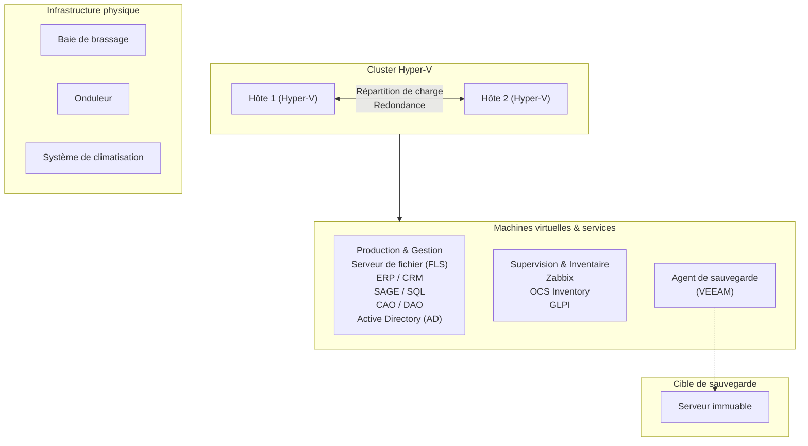
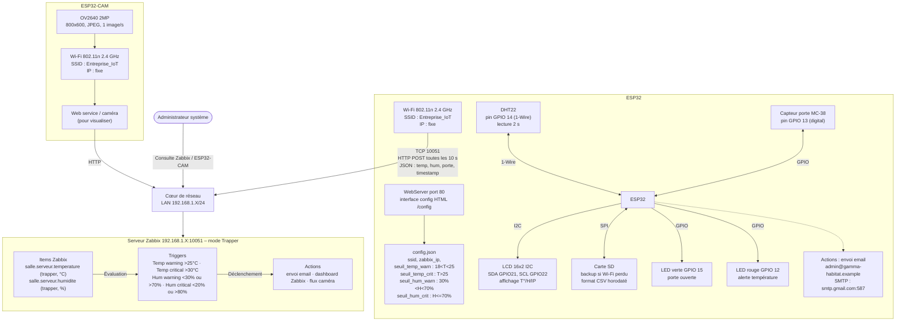
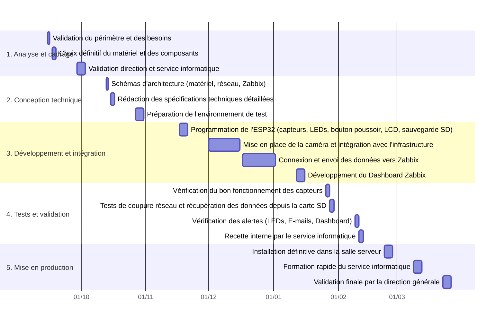
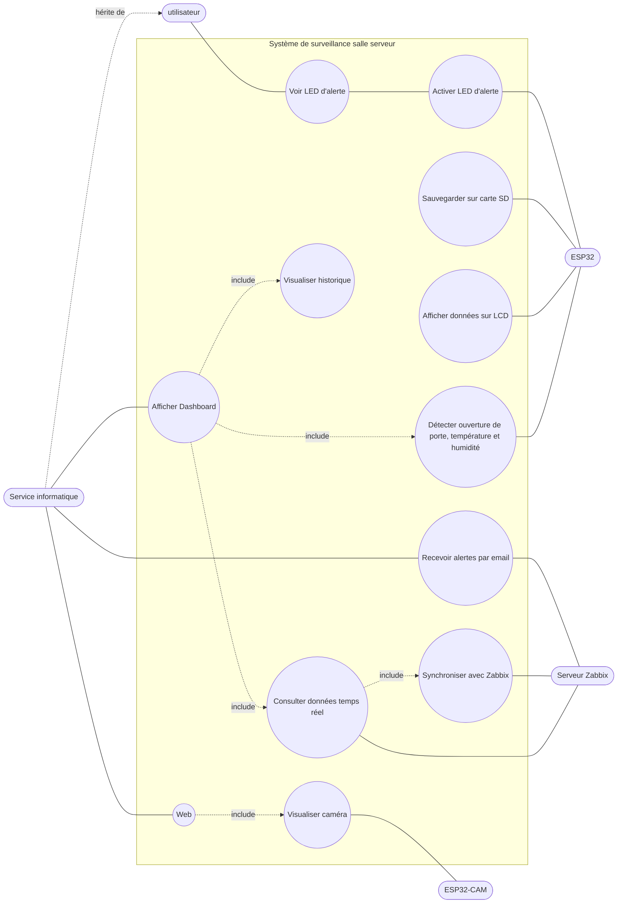

# Exemple 3 – Surveillance environnementale d'une salle serveur

> Fiche de présentation E6 d'un apprenti d'une session précédente, **anonymisée** : noms de personnes, d'entreprises, adresses, adresses mail et coordonnées sont fictifs ; certains chiffres permettant d'identifier l'entreprise ont été modifiés. Le contenu technique est conservé tel que rédigé par l'étudiant (fautes comprises, champs laissés vides dans l'original également vides ici). Les schémas ont été redessinés en mermaid.

**Académie de Lyon – Fiche présentation Projet E6 IR – candidat apprenti**

| Nom de l'établissement | BTS CIEL | Session |
|---|---|---|
| 1 rue de l'Exemple 00000 Ville-Exemple Tél. : 00 00 00 00 00 contact@cfa-exemple.fr | Option A Informatique et Réseaux | Session 2026 Candidat apprenti |

## Surveillance environnementale de la Salle Serveur de Gamma Habitat

**L'apprenti :**
Nom : GARNIER – Prénom : Hugo
Service dans lequel il travaille : Service Informatique

**L'entreprise d'accueil :**
Nom :
Adresse : 8 rue des Érables, 00000 Ville-Exemple.
Siret :
Activité principale : conception, fabrication et installation de vérandas sur-mesure

**Tuteur**
Nom : FAURE – Prénom : Antoine
Fonction : Responsable des systèmes d'information

**Centre de formation :**
Nom :
Professeur de Sciences et techniques Industriels – Nom : BERNARD / DUPONT – Prénom : Luc / Jean
Professeur de Sciences Physiques – Nom : MARTIN – Prénom : Claire

---

### Synthèse du projet

La salle serveur de Gamma Habitat ne dispose actuellement d'aucun dispositif permettant de surveiller les conditions environnementales. Une surchauffe, une augmentation d'humidité non contrôlée de la salle peuvent provoquer des arrêts du système d'information impactant l'ensemble de la production.

Objectif : déployer une sonde basée sur un microcontrôleur ESP32, capable de mesurer en continu la température, l'humidité et l'ouverture de porte, puis d'envoyer ces informations vers l'outil de supervision Zabbix déjà utilisé par l'entreprise.

La solution intégrera :

- Un enregistrement local des données via un capteur DHT22 et un contacteur de porte type MC-38,
- une visualisation via écran I2C LCD et LED d'alerte,
- une sauvegarde automatique des données sur carte SD en cas de coupure réseau,
- une synchronisation vers Zabbix dès le retour de la connectivité et une caméra pour une vérification visuelle de la salle sans enregistrement.

### Présentation de l'entreprise

Gamma Habitat est une entreprise française spécialisée dans la conception, la fabrication et l'installation de vérandas sur-mesure depuis plus de 30 ans.
Le siège regroupe environ 100 employés avec les ateliers de production.
L'entreprise a un réseau d'agences, représentant plusieurs centaines de collaborateurs.

**Infrastructure informatique :**

Le système d'information est centralisé (on-premise) au siège sur plusieurs serveurs internes :

- la conception CAO/DAO utilisée par les bureaux d'études,
- la gestion des fichiers d'usinage,
- le fonctionnement des applications métiers (ERP, CRM),
- le logiciel pour la relation client (devis).

*CAO = Conception Assistée par Ordinateur : logiciels pour créer des plans et modèles 3D (comme TopSolid, Cadwork)*
*DAO = Dessin Assisté par Ordinateur : logiciels pour dessiner des plans techniques 2D*
*ERP = Enterprise Resource Planning : logiciel qui gère toute l'entreprise (stocks, production, comptabilité, RH, achats...)*
*CRM = Customer Relationship Management (Gestion de la Relation Client) : logiciel pour gérer les clients, devis, commandes, suivi commercial*

### Présentation générale du système supportant le projet

**L'infrastructure actuelle**

La salle serveur de Gamma Habitat héberge actuellement :

### Analyse de l'existant

La salle serveur ne dispose d'aucune surveillance : la température, l'humidité et l'ouverture de porte ne sont pas mesurées.
L'entreprise aujourd'hui n'a aucun moyen de contrôler l'intérieur de la salle mais uniquement lors d'un passage dans la salle. Une panne de climatisation ou une hausse d'humidité peut passer inaperçue pendant plusieurs heures, entraînant des risques de surchauffe et d'interruption des services métiers (CAO/DAO, ERP, CRM).

Grâce à la mise en place de ce système, nous pourrons analyser, comprendre et éventuellement anticiper les incidents ou pannes répétitives.
Exemples : filtre de climatisation encrassé, arrêt de la climatisation, coupure d'alimentation électrique, etc.
La supervision Zabbix actuelle ne remonte que les informations provenant de nos serveurs.
En ajoutant notre système, nous pourrions ajouter l'affichage Zabbix avec de nouveaux indicateurs et obtenir une vision plus globale de notre salle serveur ainsi que des services fournis.

### Expression du besoin / problème à résoudre / Contraintes techniques

**1. Exigences fonctionnelles (F) :**

- F1 : Le système doit mesurer en continu la température et l'humidité de la salle serveur à l'aide de capteurs DHT22.
- F2 : Le système doit détecter l'ouverture de la porte via un contacteur afin de signaler un risque de fausse mesure MC-38.
- F3 : Les données doivent être transmises automatiquement vers le serveur de supervision Zabbix déjà utilisé par l'entreprise.
- F4 : En cas de coupure réseau, le système doit enregistrer les mesures sur une carte SD.
- F5 : Dès le retour de la connexion réseau, le système doit synchroniser l'ensemble des données stockées sans perte.
- F6 : Le système doit afficher localement les mesures sur un écran LCD.
- F7 : Le système doit signaler les anomalies à l'aide de deux LED (une pour les alertes, une pour l'ouverture de porte).
- F8 : Le système doit permettre la visualisation en temps réel de la salle via une caméra, uniquement en direct, sans enregistrement.
- F9 : L'ensemble des alertes (température, humidité, ouverture de porte, défaut réseau) doit être remonté sur Zabbix.

**2. Exigences contraintes (C) :**

- C1 : Le système doit fonctionner en Wi-Fi sur l'infrastructure existante de l'entreprise.
- C2 : En cas de coupure réseau Wi-Fi, Les données doivent continuer à être collectées.
- C3 : L'affichage local doit rester lisible et compréhensible immédiatement par l'équipe informatique.
- C4 : La caméra : pas d'enregistrement, pas de stockage vidéo, uniquement un flux direct.
- C5 : Le matériel doit être compact et protégé.
- C6 : L'installation doit être simple, sans modification majeure de l'infrastructure existante.

**3. Critères de performance (P) :**

- P1 : Aucune perte de données ne doit survenir après une coupure réseau ;
- P2 : Une fois le réseau wifi réactivé, les valeurs doivent être entièrement synchronisées via Zabbix.
- P3 : Les alertes doivent être émises immédiatement dès le dépassement des seuils (LED, Zabbix).
- P4 : L'actualisation des mesures doit être visible en temps réel sur l'écran LCD et dans Zabbix.
- P5 : Le stockage sur carte SD doit permettre d'enregistrer les mesures sur toute la durée d'une interruption réseau.

**4. Matériel et technologies utilisées :**

- Microcontrôleur : ESP32 pour le contrôle global du système ; ESP32-CAM pour la visualisation.
- Affichage : écran LCD 16×2 avec interface I2C.
- Capteurs : DHT22 pour les mesures de température et d'humidité.
- Détection : contacteur magnétique MC-38 pour détecter l'ouverture de la porte.
- Stockage : carte SD pour l'enregistrement local des données en cas de coupure réseau.
- Alertes :
  - LED verte : indication d'ouverture de porte,
  - LED rouge : signalement d'anomalies (température/humidité hors seuil, etc.).
- Caméra : module OV2640 pour la visualisation en temps réel avec ESP32-CAM.
- Supervision : Le serveur Zabbix déjà présent dans l'entreprise en utilisant les port 10051(UDP Trapper).
- Réseau : Communication en 2,4 gHz avec le module Wi-Fi ESP32 (802.11N).

**5. Contraintes de planning et d'organisation :**

Le projet doit être finalisé avant avril 2025. Ce délai inclut :
Développement et tests en atelier entre novembre et janvier.
Validation en conditions réelles en février.
Déploiement définitif et formation des utilisateurs en mars.
Phase de suivi et corrections éventuelles en avril.

**6. Budget :**

Le budget couvre l'achat des composants nécessaires : ESP32, capteurs, carte SD, écran LCD, LED, caméra, câbles et alimentation. L'ensemble devra être validé par la direction.

### Synoptique du système

*Architecture de monitoring environnemental – ESP32 vers Zabbix*

**Justifications techniques (extrait du synoptique original) :**

- ESP32-CAM : Wi-Fi 802.11b/g/n intégré (2,4 GHz), double cœur 240 MHz, 520 KB SRAM, caméra OV2640 2MP intégrée, support Arduino/ESP-IDF.
- DHT22 (AM2302) : plage température -40 °C à +80 °C, plage humidité 0-100 % RH, précision ±0,5 °C / ±2 % RH, interface 1-Wire, échantillonnage 2 s.
- Zabbix (Trapper) : l'ESP32 pousse les données, API REST HTTP simple, gestion triggers/alertes native, dashboard personnalisable, historique illimité (BDD).

### Énoncé des tâches à réaliser par l'apprenti (Gantt)

| Tâches | Activités | Contrats de tâche | Compétences | Candidat |
|---|---|---|---|---|
| | | **Élaboration du cahier des charges** | | |
| T1 | D1 | Identifier les besoins fonctionnels et techniques | C03 – Gérer un projet | X |
| T1 | D2 | Valider le périmètre et les contraintes matérielles et logicielles | C03 – Gérer un projet | X |
| T1 | D3 | Rédiger le cahier des charges | C01 – Communiquer en situation professionnelle C03 – gérer un projet | X |
| T1 | D4 | Organisation du projet (avec les comptes rendus et les points jalons du projet « gantt ») | C01 – Communiquer en situation professionnelle C03 – gérer un projet | X |
| T1 | D5 | Modéliser le système (UML : cas d'usage, séquence, déploiement) | C01 – Communiquer en situation professionnelle C03 – gérer un projet | X |
| | | **Développement et intégration** | | |
| T2 | D1 | Développer le firmware ESP32 en C++ : acquisition DHT22 (1-Wire), interruptions porte, buffer SD (FAT32), Wi-Fi (WPA2) | C08 - Coder | X |
| T2 | D2 | Créer interface web embarquée (HTML/CSS/JS) pour configuration ESP32 : SSID/password, seuils alertes, serveur Zabbix | C08 - Coder | X |
| T2 | D3 | Créer interface web embarquée pour configuration ESP32-CAM | C08 – Coder C10 - Exploiter un réseau informatique | |
| T2 | D4 | Implémenter protocole Zabbix Trapper (TCP 10051) : envoi métriques JSON, gestion file d'attente locale | C08 – Coder C10 - Exploiter un réseau informatique | X |
| T2 | D5 | Configurer dépôt Git (GitHub) : versionning code C++, documentation Markdown, schémas électroniques | C01 - Communiquer en situation professionnelle C08 - Coder C10 - Exploiter un réseau informatique | X |
| | | **Tests et documentation** | | |
| T3 | D1 | Réaliser tests entre chaque jalon : unitaires (capteurs), intégration (Zabbix), fail-over réseau | C03 - Gérer un projet C10 - Exploiter un réseau informatique | X |
| T3 | D2 | Optimiser performances : consommation réseau, buffer mémoire, latence envoi Zabbix | C08 - Coder C10 - Exploiter un réseau informatique | X |
| T3 | D3 | Rédiger manuel technique (architecture, modules, API) et manuel utilisateur | C01 – Communiquer en situation professionnelle C03 - Gérer un projet C10 - Exploiter un réseau informatique | X |
| | | **Déploiement et validation** | | |
| T4 | D1 | Présentation finale devant la commission avec démonstrateur | C01 – Communiquer en situation professionnelle | X |
| T4 | D2 | Installation en production : montage boîtier, connexion réseau, configuration Zabbix | C10 - Exploiter un réseau informatique C03 - Gérer un projet | X |

**Contexte d'application :**
Supervision & milieu industriel pour les services (ERP, DAO,

### Description des entrées et données

| Entrées | Descriptions | |
|---|---|---|
| Capteurs | DHT22 (Mesure température & humidité); Caméra (pour voir en temps réel, sans enregistrement) ; Capteur détection ouverture de porte | × |
| Données collectées | DHT22 (Mesure température & humidité) en format CSV ; Ouverture porte | × |
| Flux entrants | | |
| API | Zabbix trapper (Envoi) | × |
| Fichiers | Carte mémoire SD (en cas de coupure réseau/Wi-Fi) en format CSV | × |

**Sorties du système :**

| Résultats produits | Descriptions | |
|---|---|---|
| Commandes d'actionneurs | Lampe verte & rouge | × |
| Visualisations (IHM) | Dashboard via Zabbix | × |
| Alertes | Lampe verte & rouge, Mail, Sur l'écran LCD. | × |
| API | Zabbix trapper (réception) | × |
| Logs | Température/ Humidité sur ESP32 | × |

### Ressources mobilisées

- **Matériel :**
  Microcontrôleur : ESP32 pour le contrôle global du système ; ESP32-CAM pour la visualisation.
  Affichage : écran LCD 16×2 avec interface I2C.
  Capteurs : DHT22 pour les mesures de température et d'humidité.
  Détection : contacteur magnétique MC-38 pour détecter l'ouverture de la porte.
  Stockage : carte SD pour l'enregistrement local des données en cas de coupure réseau.
  Alertes : - LED verte : indication d'ouverture de porte,
  - LED rouge : signalement d'anomalies (température/humidité hors seuil, etc.).
  Caméra : module OV2640 pour la visualisation en temps réel avec ESP32-CAM.
  Supervision : Le serveur Zabbix déjà présent dans l'entreprise en utilisant les port 10051(UDP Trapper).
  Réseau : Communication en 2,4 gHz avec le module Wi-Fi ESP32 (802.11N).
- **Logiciel :** C++, Zabbix, SQL, VSCode, Fork (pour github)
- **Organisation :**
  Ganttprojet (gestion des tâches),
  GitHub (versionnage du projet),
  Outlook (gestion de projet avec look)

### Résultats obtenus

Vidéo, prototypes, photo, docs techniques.

---

## Annexe – UML : cas d'utilisation

*Système de surveillance salle serveur*

*La fiche originale contenait ensuite la grille d'auto-évaluation (voir `grille_auto_eval-1.pdf`) et la page « Avis de la commission » du modèle officiel, non reproduites ici.*
