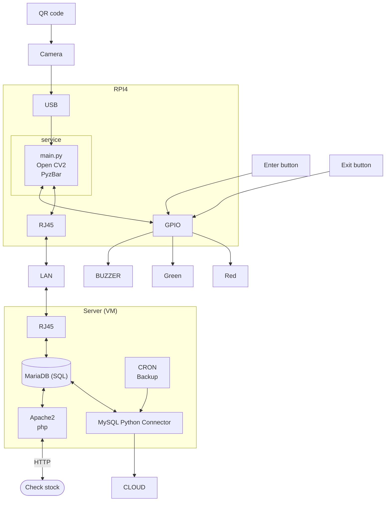
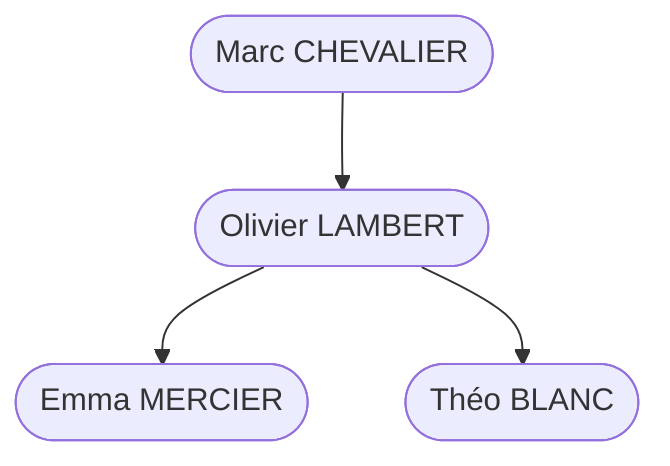

# Exemple 4 – Gestion de stock par QR code

> Fiche de présentation E6 d'un apprenti d'une session précédente, **anonymisée** : noms de personnes, d'entreprises, adresses, SIRET, dirigeants et coordonnées sont fictifs ; la date de création et la localisation de l'entreprise ont été retirées. Le contenu technique est conservé tel que rédigé par l'étudiant (fautes comprises). Les schémas ont été redessinés en mermaid.

**Académie de Lyon – Fiche présentation Projet E6 IR – candidat apprenti**

| Centre de formation | BTS CIEL | Session |
|---|---|---|
| CFA Exemple 1 rue de l'Exemple 00 00 00 00 00 contact@cfa-exemple.fr | Option A Informatique et Réseaux | Session 2026 Candidat apprenti |

## Gestion de stock

**L'apprenti :**
Nom : MERCIER – Prénom : Emma
Service dans lequel il travaille : Service Informatique

**L'entreprise d'accueil :**
Nom : OMEGA LOGISTIQUE
Adresse : 3 rue des Peupliers
Siret : 000 000 000 00000
Activité principale : Conception, négoce et vente de matériel pour la manutention et la logistique

**Tuteur**
Nom : LAMBERT – Prénom : Olivier
Fonction : Administrateur Réseau – Diplôme : BTS informatique

**Centre de formation :**
Nom : CFA Exemple
Professeur de Sciences et techniques Industriels – Nom : DUPONT – Prénom : Jean
Professeur de Sciences Physiques – Nom : MARTIN – Prénom : Claire

---

### 1 - Synthèse du projet

Le projet mené au sein de Omega Logistique s'inscrit dans une démarche d'amélioration continue du service informatique, dont l'objectif est de moderniser la gestion du stock matériel.

Les entrées et sorties de matériels seront tracés grâce à la lecture d'un QR code, connecté au Raspberry PI, l'intégration des LED de signalisation indiquent en temps réel la réussite ou l'échec des opérations. Les entrées et sorties de matériel dans une base MySQL

La gestion du stock s'effectuera via un nouvel appareil développer en interne, l'objectif de ce dernier étant de simplifier la gestion actuelle. Jusqu'à présent, le suivi des équipements (PC, écrans, périphériques, casques, composants divers) s'effectuait à l'aide d'un simple fichier Excel partagé. Cette méthode, bien qu'intuitive, présentait plusieurs limites : manque de fiabilité, absence de traçabilité, surcharge administrative et risque d'erreurs humaines lors des saisies manuelles.

Afin de répondre à ces problématiques, le projet a consisté à concevoir et déployer un système automatisé capable d'assurer la gestion, la traçabilité et la mise à jour du stock en temps réel. Pour ce faire un dispositif muni d'une caméra sera mis en place pour scanner les QR codes qui correspondront aux équipements à stocker. Les données seront envoyées dans une base de données qui sera accessible via une interface WEB.

**Figure 1 : Synoptique**

### 2 - Présentation de l'entreprise

Omega Logistique est une entreprise innovante fondée il y a une dizaine d'années. Elle est spécialisée dans la conception et la fabrication de solutions modulaires et connectées pour l'intralogistique, c'est-à-dire l'ensemble des opérations de manutention, de stockage et de préparation de commandes à l'intérieur des entrepôts et des sites de production.
L'entreprise s'est distinguée sur le marché grâce à sa gamme de convoyeurs intelligents, de systèmes de stockage automatisés et de logiciels de pilotage d'entrepôts.

Ses solutions sont principalement destinées aux secteurs du e-commerce, du retail, de la logistique et de l'industrie, où la rapidité, la flexibilité et la traçabilité des flux sont devenues essentielles.
Omega Logistique a développé un concept unique basé sur trois piliers :

- La modularité, qui permet d'assembler rapidement des lignes de convoyage ou des zones de stockage sans nécessiter de lourds travaux d'intégration.
- L'intelligence embarquée, grâce à des équipements communicants et autonomes, capables d'adapter leur comportement aux besoins de la chaîne logistique.
- La robotisation de la manutention, qui vise à réduire les tâches répétitives et à améliorer l'efficacité globale des entrepôts.

Dirigée par ses deux fondateurs, l'entreprise poursuit une croissance soutenue, aussi bien en France qu'à l'international. Elle s'appuie sur la tendance forte de digitalisation et d'automatisation des entrepôts, ainsi que sur une politique d'innovation continue, soutenue par des investissements en recherche et développement.
Aujourd'hui, Omega Logistique compte plusieurs dizaines de collaborateurs répartis entre les pôles ingénierie, production, développement logiciel et support technique. L'entreprise s'est imposée comme un acteur majeur dans le domaine de l'intralogistique intelligente, grâce à des solutions à la fois performantes, évolutives et respectueuses de l'environnement.

### 3 - Présentation du service informatique

Au sein de cette structure technologique, le service informatique joue un rôle essentiel dans la gestion et le maintien en conditions opérationnelles des systèmes et équipements utilisés par l'ensemble des collaborateurs.
Ce service, composé de trois collaborateurs, est dirigé par Olivier LAMBERT et placé sous la supervision de Marc CHEVALIER, directeur de la Supply Chain.

**Figure 2 : Organigramme**

Ses principales missions concernent :

- Le support technique aux utilisateurs (matériel, réseau, logiciels, sécurité),
- La gestion du parc informatique et des ressources associées (postes, serveurs, licences, périphériques),
- Le déploiement d'outils internes facilitant la maintenance, le suivi et l'automatisation des processus numériques de l'entreprise,
- La participation à des projets transverses visant à améliorer la productivité et la sécurité des systèmes d'information.

### 3 - Présentation générale du système supportant le projet

Le projet s'appuie sur l'environnement informatique interne de Omega Logistique, interconnecté via un réseau local (LAN) d'entreprise regroupant postes de travail, serveurs virtuels et équipements réseau (pare-feu, commutateurs, bornes Wi-Fi).

Dans ce contexte, le projet vise à concevoir un système embarqué autonome destiné à la gestion automatisée du stock matériel informatique.

Ce système repose sur un Raspberry Pi, jouant le rôle d'un micro-serveur connecté au réseau interne, couplé à un lecteur QR code et une base de données MySQL hébergée sur une machine virtuelle Ubuntu server 24LTS.
L'ensemble forme une architecture légère, modulaire et interconnectée, permettant la saisie automatisée, la validation instantanée et la centralisation sécurisée des mouvements de stock.

### 4 - Architecture globale du système

1. **Le Raspberry Pi**
   - Remplace le poste hôte traditionnel pour assurer une solution autonome et économe en énergie.
   - Exécute le programme principal de gestion : réception des données du lecteur QR.
   - Se connecte au réseau local de Omega Logistique via Ethernet ou Wi-Fi, permettant l'accès distant à la base MySQL hébergée sur la machine virtuelle.
   - Fonctionne sous Raspberry Pi OS (Linux Debian) et héberge les scripts applicatifs développés en Python, assurant la portabilité et la fiabilité du système.
   - Voyant et bouton (GPIO) :
     - Fournit un retour visuel à l'utilisateur :
       1. LED verte → enregistrement validé et ajouté à la base de données.
       2. LED rouge → erreur de lecture, code inconnu ou échec de transmission.
     - Un bouton poussoir permet d'effectuer une validation manuelle ou de relancer une opération.
2. **Camera USB (lecteur QR code)**
   - Connecté au Raspberry Pi via port USB (mode HID), il lit les identifiants uniques des matériels (numéro de série, référence, code interne).
   - Les informations scannées sont envoyées au script Python pour traitement et enregistrement dans la base de données.
3. **La base de données MySQL (VM Ubuntu server)**
   - Hébergée sur une VM, elle centralise toutes les données du stock (identifiants, catégories, quantités, mouvements, utilisateurs).
   - L'accès est restreint au réseau local de l'entreprise pour garantir sécurité et intégrité.
   - Des sauvegardes automatisées sur OneDrive assurent la résilience du système et la possibilité de restauration en cas d'incident.

### 5 - Objectifs techniques et fonctionnels du système

Le système vise à :

- Automatiser la gestion du stock lors des entrées et sorties de matériel via la lecture QR.
- Supprimer la saisie manuelle et fiabiliser les mises à jour dans la base MySQL.
- Offrir un retour visuel immédiat à l'utilisateur lors de chaque opération.
- Centraliser et sécuriser les données sur l'infrastructure existante de Omega Logistique.
- Réduire les erreurs humaines et le temps de traitement des inventaires.

### 6 - Intégration dans l'infrastructure de Omega Logistique

Le projet s'intègre pleinement à l'infrastructure informatique existante sans nécessiter d'équipements lourds supplémentaires.
Le Raspberry Pi agit comme une passerelle autonome, connectée au réseau LAN, et communique avec la machine virtuelle MySQL du service IT.
Sa compacité et sa faible consommation permettent un déploiement flexible, pouvant être positionné directement dans la salle informatique ou près de la zone de stockage du matériel.
Le système est conçu pour être évolutif : à moyen terme, il pourra intégrer de nouvelles fonctionnalités telles que :

- Une interface web de consultation et d'administration du stock,
- L'ajout d'un tableau de bord de suivi en temps réel,
- Ou la génération automatique de rapports PDF destinés à la direction technique.

### 7 - Analyse de l'existant

Actuellement la gestion du stock matériel repose sur une méthode manuelle et décentralisée.
Les techniciens utilisent principalement un fichier Excel partagé pour enregistrer les mouvements de matériel (entrées, sorties, prêts, retours).

Ce document est accessible depuis le réseau interne, mais son utilisation présente plusieurs limites fonctionnelles et organisationnelles.
Chaque mise à jour nécessite une saisie manuelle du code ou du nom du matériel, ce qui génère fréquemment des erreurs, des doublons ou des oublis.
De plus, il n'existe aucun contrôle automatisé de cohérence entre les données (quantités, numéros de série, emplacements, utilisateurs).

Lors des inventaires ou des dépannages, la recherche d'un équipement est souvent chronophage, car elle dépend de la bonne tenue du tableau par tous les utilisateurs.

Par ailleurs, aucun système d'alerte ou de validation n'est mis en place : un technicien ne peut pas savoir immédiatement si une mise à jour a été correctement réalisée, ni si une erreur de saisie s'est produite.
Les historiques des mouvements sont partiels et difficiles à exploiter, car le fichier Excel ne conserve qu'une partie des modifications.

Utilisateur → Saisie manuelle Excel → Fichier réseau → Inventaire ponctuel

### 8 - Expression du besoin / problème à résoudre / Contraintes

**Expression du besoin :**

Nous souhaitons moderniser la gestion du stock matériel (composants électroniques, périphériques, ordinateurs, etc.).

Aujourd'hui, comme dit dans l'analyse de l'existant le fichier Excel représente beaucoup de problème.

L'objectif du projet est donc de concevoir et de déployer une solution autonome et connectée capable de numériser et automatiser les mouvements de stock tout en fournissant un retour visuel immédiat à l'utilisateur.
Le système doit pouvoir enregistrer automatiquement les entrées et sorties de matériel dans une base de données centralisée MySQL.

L'ensemble de la gestion sera assuré par un Raspberry Pi, agissant comme une passerelle intelligente entre le lecteur QR code et la base de données MySQL.

L'utilisateur scannera simplement un QR code pour ajouter, retirer et sera informé immédiatement du résultat de l'opération grâce au deux voyants LED (verte pour succès, rouge pour erreur).

**Problème à résoudre :**

Le problème principal identifié est le manque d'automatisation et de fiabilité dans la gestion du stock informatique.

Le projet doit donc répondre à plusieurs enjeux :

1. Automatiser le processus d'enregistrement des mouvements de stock à partir du scan d'un QR code.
2. Éliminer la saisie manuelle et les erreurs associées.
3. Assurer une mise à jour immédiate de la base de données.
4. Garantir un retour utilisateur clair et instantané.
5. Renforcer la traçabilité et la sécurité des données internes.

L'objectif final est de disposer d'un outil autonome, fiable et simple d'utilisation, adapté aux besoins quotidiens du service informatique et intégrable au réseau local existant.

**Contraintes matérielles :**

- Utilisation d'un Raspberry Pi (modèle 3B+ ou 4) comme unité centrale.
- Connexion d'un lecteur QR code USB (mode HID).
- Gestion des GPIO :
  - Une LED verte (succès),
  - Une LED rouge (échec ou erreur),
  - Un bouton poussoir (validation ou annulation).
- Connexion au réseau local (LAN) via Ethernet ou Wi-Fi.

**Contraintes logicielles :**

- Développement en Python 3 pour assurer et maintenance simplifiée.
- Utilisation du connecteur MySQL (bibliothèque MySQL-connector-python).
- Système d'exploitation Raspberry Pi OS (Debian).
- Accès distant sécurisé à la base MySQL.
- Création d'un service linux (systemd) pour le démarrage automatique.
- Base de données structurée en trois tables principales :
  - Matériel (références, désignations, quantité),
  - Mouvements (entrées, sorties, dates, utilisateur),
  - Utilisateurs (droits d'accès, identifiants).

**Contraintes réseau et sécurité :**

- L'accès à la base MySQL est restreint au réseau interne.
- Utilisation d'un compte MySQL dédié avec privilèges limités.
- Mise en place de sauvegardes automatiques de la BDD.
- Configuration du pare-feu et filtrage de port TCP 3306.

**Contraintes fonctionnelles :**

- Le système doit fonctionner en autonomie complète sans dépendre d'un poste utilisateur.
- Temps de réponse d'une opération (scan → validation LED) : < 2 secondes.
- Interface minimale ou terminal de supervision pour visualiser les logs et l'état du stock.
- Possibilité future d'ajouter une interface graphique ou web pour consultation du stock.

### 9 - Énoncé des tâches à réaliser par l'apprenti

**Phase 1 : Mise en place et configuration de l'environnement**

- Installation et configuration du Raspberry Pi OS sur carte microSD.
- Mise à jour du système et installation des dépendances nécessaires (Python, MySQL Connector,, etc.).
- Connexion du Raspberry Pi au réseau local de Omega Logistique (Wi-Fi/Ethernet).
- Configuration de la machine virtuelle Ubuntu server et installation du serveur MySQL.
- Création du modèle de base de données (tables : Matériel, Mouvements, Utilisateurs).
- Vérification de la communication entre le Raspberry Pi et la VM MySQL (ping).
- Branchement des différents éléments (boutons poussoir, LED, buzzer) sur les ports GPIO du Raspberry pi.

**Phase 2 : Développement applicatif et communication inter-modules**

- Développement du script principal python assurant la lecture du QR code, l'analyse des données et l'enregistrement dans la base MySQL.
- Mise en place d'un script de démarrage automatique (service systemd) permettant un lancement au boot du Raspberry Pi.
- Gestion des logs applicatifs pour assurer le suivi des opérations via un fichier log.
- Tests unitaires des différents composants.
- Configuration des différents composants (boutons poussoir, LED, buzzer) avec python.

**Phase 3 : Tests, validation et optimisation**

- Réalisation de tests d'intégration entre le lecteur QR, le Raspberry Pi et la base MySQL.
- Conception d'un plan de test complet :
  - Liaison BDD opérationnelle,
  - Test de latence (traitement ≤ 2 s),
  - Vérification des enregistrements des logs.
- Vérification du bon fonctionnement réseau et de la sécurité des connexions (droits MySQL, pare-feu, stabilité).
- Optimisation des scripts (gestion d'erreurs, fiabilité, vitesse d'exécution).
- Validation finale du fonctionnement complet du système.

**Phase 4 : Documentation et livrables**

- Rédaction du guide utilisateur expliquant l'utilisation du système.
- Rédaction du manuel technique : architecture, schémas de câblage, structure de la base, configuration réseau.
- Création d'un rapport de validation résumant les résultats des tests et les performances obtenues.
- Préparation de la présentation orale et démonstration fonctionnelle du système devant la commission.

**Compétences mobilisées**

- C01 – Communiquer en situation professionnelle (français / anglais)
  → Rédaction du cahier des charges, guide utilisateur et soutenance.
- C03 – Gérer un projet
  → Planification, suivi des tâches, validation et documentation.
- C08 – Coder
  → Développement en Python, gestion des échanges de données.
- C10 – Exploiter un réseau informatique
  → Configuration du Raspberry Pi, de la VM et du serveur MySQL.

**Livrables attendus**

- Système embarqué complet Raspberry Pi + VM opérationnel.
- Base de données MySQL fonctionnelle et sécurisée.
- Script Python documenté.
- Guide utilisateur et manuel technique.
- Rapport de validation et présentation finale.

**Contexte d'application :**
Milieu industriel – Automatisation – Supervision – Base de données – Réseau local – Cybersécurité – Système embarqué – Gestion de stock – Valorisation de données – Python – Raspberry Pi – MySQL – Virtualisation – Maintenance informatique.

### Description des entrées et données

| Entrées | Descriptions | |
|---|---|---|
| Capteurs | Lecteur QR code (lecture d'identifiants matériels) ; Boutons poussoirs gérer par Raspberry Pi | ☑ |
| Données collectées | Identifiants de matériels (code QR), date et heure de scan, type de mouvement (entrée/sortie), utilisateur, statut d'intégration dans la base | ☑ |
| Flux entrants | Données issues du lecteur QR code vers le Raspberry Pi → transmission vers la base MySQL ; | ☑ |
| API | Communication MySQL via connecteur Python (mysql-connector-python) – échanges de requêtes SQL entre le Raspberry Pi et la VM | ☑ |
| Fichiers | Fichiers de logs générés sur le Raspberry Pi (journalisation des opérations et erreurs) | ☑ |

**Sorties du système :**

| Résultats produits | Descriptions | |
|---|---|---|
| Commandes d'actionneurs | Bouton poussoir afin d'ajouter/retrier un article au stock | ☑ |
| Visualisations (IHM) | Affichage depuis l'interface web (Apache2) | ☑ |
| Alertes | Notification visuelle immédiate par LED rouge en cas d'échec de communication ou d'erreur de base de données | ☑ |
| API | Envoi et réception de requêtes SQL via le connecteur Python (mysql-connector-python) vers la base MySQL sur la machine virtuelle | ☑ |
| Logs | Génération de fichiers journaux sur le Raspberry Pi enregistrant la date, le type d'action, le code scanné et le résultat du traitement | ☑ |

### Ressources mobilisées

- **Matériel :**
  Raspberry Pi 4 – Lecteur QR code USB (camera) – LEDs – Bouton poussoir – GPIO – Carte microSD – Alimentation 5 V – Serveur virtuel Ubuntu ( VM ) – Base de données MySQL – Commutateurs réseau – Routeur – Poste de configuration – Écran et clavier temporaires pour Raspberry Pi.
- **Logiciel :**
  Raspberry Pi OS (Debian) – Python 3 – MySQL Server – MySQL Workbench – Bibliothèque mysql-connector-python – Visual Studio Code – SSH – Outils de supervision réseau – Machine virtuelle Ubuntu – Service systemd (démarrage automatique) – OpenSSH – Éditeur de texte Nano – Terminal Linux (bash) – Tests unitaires Python.
- **Organisation :**
  Gestion de projet – Trello – Git / GitHub – Planification par jalons – Suivi des versions – Méthodologie en cycle en V – Réunions de validation – Documentation technique – Tests unitaires – Veille technologique – Autoformation – Compte rendu d'avancement – Revue finale du projet.

### Résultats obtenus

Système embarqué fonctionnel – Prototype opérationnel sur Raspberry Pi – Lecture automatique de QR code – Enregistrement en base MySQL – Validation par LED verte/rouge – Journalisation des opérations – Tests unitaires validés – Base de données centralisée – Démonstration en conditions réelles – Documentation technique complète.

*La fiche originale contenait ensuite la grille d'auto-évaluation (voir `grille_auto_eval-1.pdf`) et la page « Avis de la commission » du modèle officiel, non reproduites ici.*
